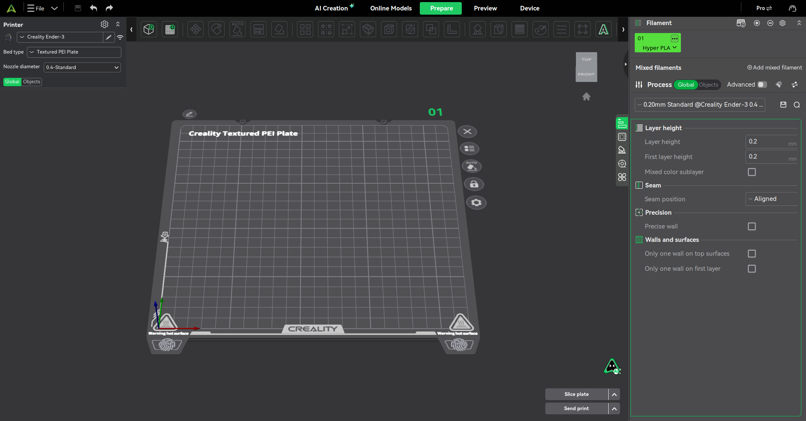

# Creality Print for Bazzite

**Double-click Creality Print on Bazzite with the compatibility fixes built in.**

An unofficial compatibility repack of **Creality Print 7.3.0.6157 for x86_64**.
It bundles the missing bzip2 library and defaults to XWayland with WebKit's
DMABUF renderer disabled—the launch settings confirmed working in the original
Bazzite troubleshooting session. No `sudo`, system-library symlinks, or
`rpm-ostree` layering are needed to run it on the tested system.

| | |
| --- | --- |
| Target | Bazzite 44, KDE Plasma Wayland, x86_64 |
| Upstream | [Creality Print 7.3.0.6157](https://github.com/CrealityOfficial/CrealityPrint/releases/tag/v7.3.0) |
| Compatibility revision | 1.0.0 |
| Packaging | AppImage; also supports extraction without FUSE |
| Validation | [Local verification results](docs/VALIDATION.md) |

This project is independent of Creality and Bazzite. Other Fedora releases,
other GPUs, and other Creality Print versions need their own validation.



## Run

Use `crealityprint-bazzite.AppImage` from a published release, or create it with
the build instructions below. A repository containing these sources does not
by itself provide a binary download.

```bash
chmod +x crealityprint-bazzite.AppImage
./crealityprint-bazzite.AppImage
```

After making it executable, you can also double-click it in your file manager.
Keep it in a permanent location if you integrate it with an AppImage manager.
The embedded menu name is **Creality Print (Bazzite)**. Model filenames and other
arguments are forwarded to Creality Print, including paths containing spaces.

If a release includes the checksum file, verify it from the same folder:

```bash
sha256sum -c crealityprint-bazzite.AppImage.sha256
```

The checksum detects corruption; it is not a publisher signature.

## What changed

| Problem | Compatibility change |
| --- | --- |
| `libbz2.so.1.0` is missing | Bundle an actual copy of the host's x86_64 libbzip2 1.0.8 under the required name; no absolute symlink back to the build machine |
| Startup ends with a Wayland protocol error | Default to `GDK_BACKEND=x11` and `WEBKIT_DISABLE_DMABUF_RENDERER=1` |
| Bundled Expat produces version warnings with system WebKit | Remove bundled `libexpat.so*`, allowing the host's Expat to resolve normally |
| Upstream launcher discards `LD_LIBRARY_PATH` | Keep bundled library paths first and append an existing search path |
| Extracted launch fails in paths with spaces | Quote path resolution and preserve every argument |
| Upstream locale and hybrid-GPU workarounds | Retain `LC_ALL=C` and GPU selection logic; respect explicit PRIME offload |

The slicer executable and printer profiles are unchanged. The package still
uses host libraries such as GTK, WebKitGTK, Expat and GPU drivers; it is not a
fully self-contained Linux runtime. `libx264` and `libspeexdsp` are already in
the upstream AppImage and remain bundled.

The bzip2 problem is documented in
[Creality issue #566](https://github.com/CrealityOfficial/CrealityPrint/issues/566).
Related Wayland/WebKit failures are documented in
[WebKit bug #280210](https://bugs.webkit.org/show_bug.cgi?id=280210).
This package keeps the settings that worked on the tested machine; it does
not assume they are the best settings for every graphics stack.

## Build your own AppImage

Build on x86_64 Bazzite with Python 3.10+, Bash, `unsquashfs`, `ldd`, the host's
bzip2 1.0.8, and a trusted copy of
[appimagetool](https://github.com/AppImage/appimagetool/releases).
The local Bazzite 44 system already provided the tools other than appimagetool.
The builder checks required tools and libraries and never installs packages.

1. Download the exact
   [upstream 7.3.0.6157 AppImage](https://github.com/CrealityOfficial/CrealityPrint/releases/download/v7.3.0/CrealityPrint-V7.3.0.6157-x86_64-Release.AppImage).
2. Download the official x86_64 appimagetool and make it executable.
3. From this repository, run:

```bash
chmod +x ./appimagetool-x86_64.AppImage
python3 scripts/build.py \
  --input ./CrealityPrint-V7.3.0.6157-x86_64-Release.AppImage \
  --appimagetool ./appimagetool-x86_64.AppImage
```

Paths outside the repository work too; quote paths containing spaces.
The upstream input does not need executable permission. Its SHA-256 must match
[`packaging/upstream.json`](packaging/upstream.json), which pins the exact
release. Use the original Creality image as input, not a compatibility repack.

The builder creates:

```text
dist/
  crealityprint-bazzite.AppImage
  crealityprint-bazzite.AppImage.sha256
  crealityprint-bazzite.AppImage.build.json
```

It verifies the input, extracts in a temporary directory, applies the launcher
and library changes, checks dependencies, and packages using the original
verified AppImage runtime. It does not download anything. Temporary extraction
is removed automatically; existing output files are refused. Use `--output`
to choose a new filename for another build.

Build metadata records the upstream image, launcher, builder, bzip2,
appimagetool and runtime hashes. Builds use the host's bzip2 and packaging
tool, so byte-for-byte reproducibility across machines is not claimed.

## Troubleshooting

Collect launcher settings, build information and library resolution without
starting the GUI:

```bash
./crealityprint-bazzite.AppImage --compat-diagnostics
```

If FUSE is unavailable:

```bash
./crealityprint-bazzite.AppImage --appimage-extract-and-run
```

For repeated launches without FUSE, extract once into a dedicated directory:

```bash
mkdir -p crealityprint-extracted
cd crealityprint-extracted
../crealityprint-bazzite.AppImage --appimage-extract
./squashfs-root/AppRun
```

XWayland must be available for the default X11 backend. The DMABUF workaround
can affect embedded web-view rendering performance. Advanced users can test
different settings for one launch using app-specific overrides:

```bash
CREALITYPRINT_GDK_BACKEND=wayland CREALITYPRINT_WEBKIT_DISABLE_DMABUF_RENDERER=0 \
  ./crealityprint-bazzite.AppImage
```

That opts out of the tested graphics defaults and may reintroduce the crash.
Desktop-wide `GDK_BACKEND` and `WEBKIT_DISABLE_DMABUF_RENDERER` values are
intentionally replaced by the compatibility defaults. The bundled
bzip2 copy means the old `~/.local/lib/crealityprint` workaround is no longer
required by this AppImage.

For a bug report, include the app version, Bazzite version, GPU/driver, session
type and the relevant diagnostic output. Review logs before posting: app logs
can include local paths, printer addresses or account information.

## Updates, development and publishing

A stock Creality update does not include these compatibility changes. Keep
the compatibility AppImage available when trying an upstream update. A new
upstream version requires a new hash, launcher review, rebuild and smoke test;
the builder intentionally refuses unreviewed versions.

```bash
python3 -m unittest discover -s tests -v
bash -n packaging/AppRun
```

[Publishing instructions](docs/PUBLISHING.md) cover the repository and release
assets. See [release notes](docs/RELEASE_NOTES.md) and
[attribution](THIRD_PARTY.md). Compatibility sources use AGPL-3.0-only, matching
the upstream license family; third-party components retain their own licenses.
